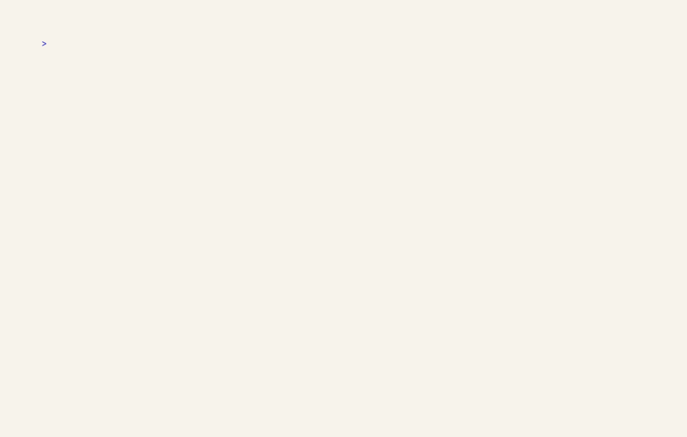

# nib

Capture and query Apple Notes, Reminders, and Calendar without leaving the terminal.



Built for macOS 26 and later. Notes uses macOS Automation, while Reminders and Calendar use native EventKit access. All three work with live Apple data.

## Install

Install the latest release:

```bash
curl --proto '=https' --tlsv1.2 -LsSf https://github.com/hectron/nib/releases/latest/download/nib-installer.sh | sh
```

Or build the current version with Cargo. This requires Rust 1.88 or newer:

```bash
cargo install --locked --git https://github.com/hectron/nib
```

## Quick start

```bash
nib n "Quick thought"
nib note list -f Work
nib t Pay rent fri '!high' '#bills'
nib today
nib task done "pay rent"
nib pick
nib task edit
nib task lists
nib note folders
nib cal calendars
nib log
nib undo
nib cal --week
nib doctor
```

`n` and `t` are capture commands. With a title, they create an item; without one, they list items. Note titles use single spaces between words, and a note folder name must match exactly one folder across your accounts. Use `nib task list --filter "due:week !pri:low"` to narrow reminders; see [Filtering reminders](docs/filter.md) for the complete syntax.

```bash
nib note new "Meeting with Team" --folder Work
nib task add "Review pull request" --due tomorrow --priority high
nib cal --calendar Work --week
nib cal --week --show-calendar
```

Quick-add recognizes natural due dates and trailing priority and list tokens. See [Quick-add reminders](docs/quick-add.md) for every form. `nib task done`, `reopen`, `priority`, and `move` change reminders by ID or title in one step, and `nib undo` reverses them; see [One-step reminder changes](docs/task-commands.md). `nib pick` opens an fzf-style prompt to filter, select, add, and act on reminders, and prints the chosen IDs for scripts; see [Picking reminders](docs/pick.md). `nib today` combines overdue and due-today reminders with today's events. Add `--show-calendar` to `nib cal` or `nib today`, or set `cal.show_calendar = true`, to show each event's calendar. `nib doctor` checks permissions and configuration without prompting.

Use `nib note folders`, `nib task lists`, and `nib cal calendars` to discover the names accepted by `--folder`, `--list`, and `--calendar`. Their `create` and `rename` subcommands manage those resources with account or source disambiguation; see [Folders, lists, and calendars](docs/resources.md). Add `--json` for stable resource and owner identifiers. The list and calendar `type` is EventKit's calendar type, such as `local`, `caldav`, or `exchange`; Apple's public EventKit API does not expose the Reminders app's list, sections, or columns view layout.

Your shell parses the command line before nib sees it. Quote titles that contain apostrophes or other shell syntax, and quote quick-add tokens beginning with `!` or `#`:

```bash
nib t "Get Apple Cider from the Farmer's Market" tomorrow '!high'
```

## Configuration

Set your defaults once in `~/.config/nib/config.toml`:

```toml
[task]
list = "Inbox"
priority = "medium"

[cal]
calendars = ["Work", "Personal"]
show_calendar = true

[note]
folder = "Notes"
```

A `nib.toml` in a project directory overrides these field by field, and `.nib.local.toml` holds personal overrides you don't commit. See [Configuration](docs/configuration.md) for every setting, environment variables, and precedence.

Run `nib config list --origin` to see every effective value and where it came from.

## Shell completions

Load completions for your shell with one line in its startup file:

```bash
# zsh: ~/.zshrc
autoload -U compinit && compinit
source <(nib completions zsh)

# bash: ~/.bashrc
source <(nib completions bash)

# fish: ~/.config/fish/config.fish
nib completions fish | source
```

You can instead install zsh completions on `fpath`:

```bash
mkdir -p ~/.zsh/completions
nib completions zsh > ~/.zsh/completions/_nib
fpath=(~/.zsh/completions $fpath)
autoload -U compinit && compinit
```

Completions include current reminder list and calendar names, recently seen Notes folders, and reminder priorities.
Live names require `nib` to be on `PATH` under that name. Aliases and relative paths still receive static completions.

After you use completions, nib stores reminder list, calendar, and Notes folder names in plain text at `~/Library/Caches/nib/completions.json` with mode `0600`. The file remains after access is revoked. Delete it to clear the cached names; nib recreates it the next time you use completions.

## Why nib

- Fast, focused commands with short aliases and useful defaults.
- Live Apple Notes capture and listing through macOS Automation.
- Native EventKit access for Reminders and Calendar.
- A daily agenda for overdue reminders, due-today reminders, and events.
- Natural due dates and quick-add tokens for reminders.
- Safe bulk reminder editing in `$VISUAL` or `$EDITOR`.
- Colored tables and JSON in the terminal, plain when piped or with `NO_COLOR` set.
- Layered TOML configuration for personal and project defaults.
- A non-persistent demo backend with dates relative to today.

Try every command without touching Apple data:

```bash
NIB_DEMO=1 nib today
NIB_DEMO=1 nib t Pay rent tomorrow '!high'
NIB_DEMO=1 nib note list
```

Nothing is saved while `NIB_DEMO=1` is set, including backups and undo history.

## Guides

- [Folders, lists, and calendars](docs/resources.md)
- [Configuration](docs/configuration.md)
- [Quick-add reminders](docs/quick-add.md)
- [One-step reminder changes](docs/task-commands.md)
- [Picking reminders](docs/pick.md)
- [Editing reminders as Markdown](docs/task-edit.md)
- [macOS permissions](docs/permissions.md)
- [JSON output](docs/json.md)
- [Contributing](CONTRIBUTING.md)

Run `nib --help` or `nib <command> --help` for the complete command reference.

## License

[MIT](LICENSE)
